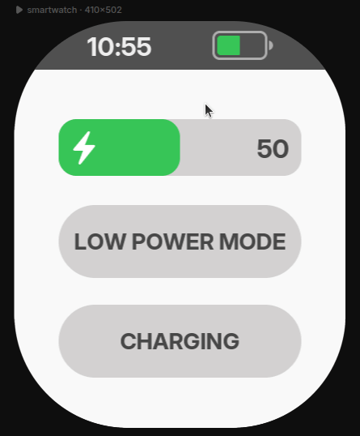
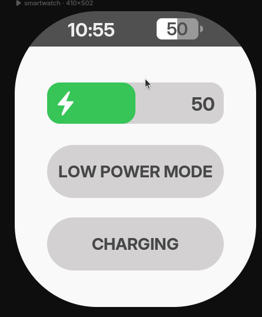
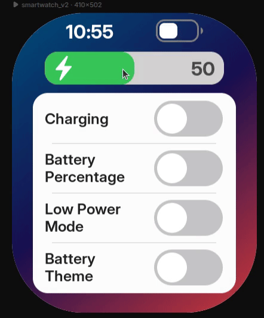
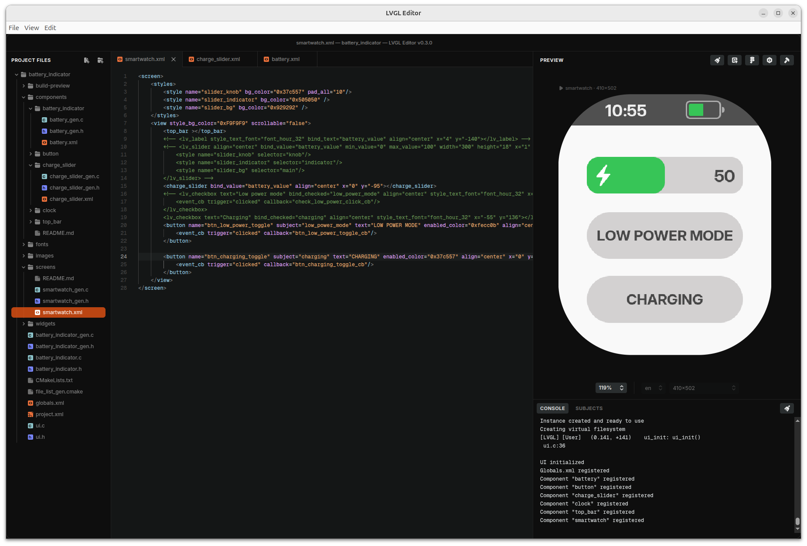
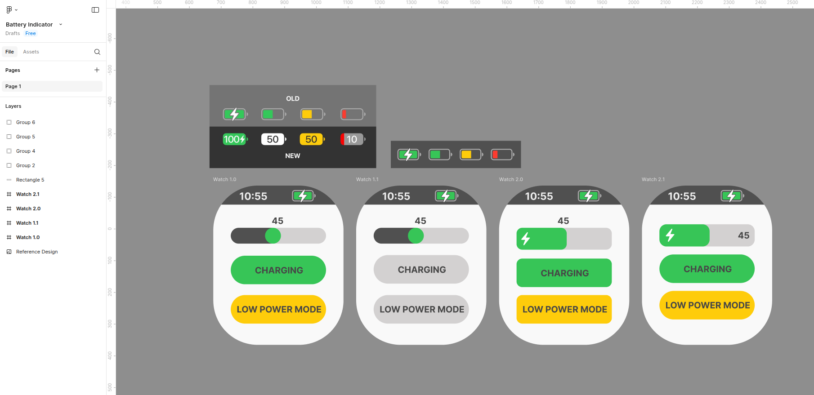
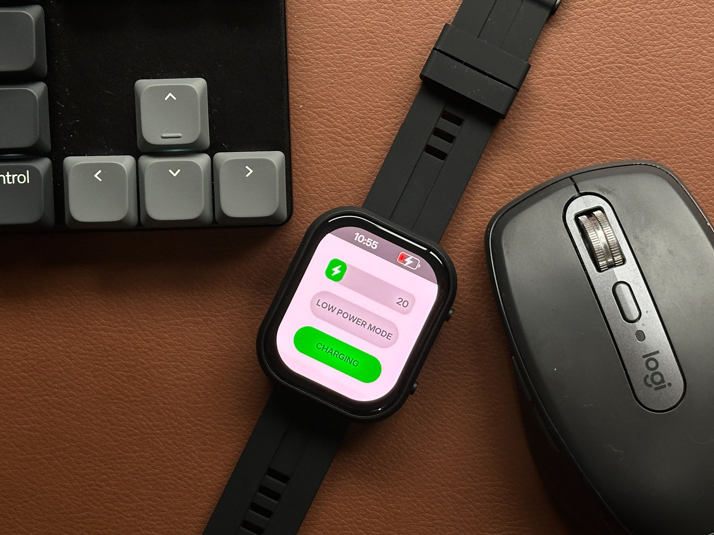

# An iOS inspired battery indicator made in LVGL's UI Editor

<!-- 
 -->

<p align="center">
  
  
  
</p>

This project is a battery indicator component example to be used in LVGL's UI Editor.
It includes battery indicator implementations that explore XML components, data bindings, custom widgets (XML + C custom code), and reactive expressions.

To test each battery design, chose one of them in the `top_bar.xml` file inside `components/top_bar`:
```
<!-- Try here the 3 different battery indicators -->

<!-- Old iOS battery indicator, full XML component -->
<!-- <battery align="right_mid"></battery> -->

<!-- New iOS battery indicator, without the normal light state, full XML component -->
<!-- <battery_indicator_2 align="right_mid"></battery_indicator_2> -->

<!-- New iOS battery indicator with light state and fully functional as a widget (XML + custom C code) -->
<wd_battery bind_charging="battery_charging" bind_low_power="low_power_mode" bind_value="battery_value" align="right_mid"></wd_battery>
```

There is a new battery indicator widget `wd_battery_v2` which has all features built in:
- Percetage mode
- Charging icon mask
- Dark/Light themes

All the features can be controlled via subjects.

Select `wd_battery_v2` in `top_bar.xml` to test it on the `smartwatch_v2.xml` screen.

The latest implementation, `battery_indicator_v3`, reproduces the features of
`wd_battery_v2` entirely as an XML component. Reactive expressions in LVGL Pro 2.1
with LVGL 9.6 make this possible without creating a custom widget or writing C
code for its behavior. Bindable properties drive the battery level, charging,
low power mode, percentage display, theme, and low battery threshold.

V3 is selected by default in `top_bar.xml`. Application subjects connect to its
properties through expressions:

```xml
<battery_indicator_v3
    align="right_mid"
    value="{battery_value}"
    charging="{battery_charging != 0}"
    low_power="{low_power_mode != 0}"
    show_percentage="{battery_show_percentage != 0}"
    theme="{battery_theme}"
    low_threshold="20"
/>
```

A small preview-only registration in `battery_indicator.c` lets the Editor use
the compiled A8 charging mask. Embedded builds use the generated asset setup;
the indicator's behavior remains in XML.

Download this repo and open the folder containing `project.xml` in LVGL Pro 2.1.0.



You can also see it live in the online preview: [Battery Indicator Online Live Preview](https://viewer.lvgl.io/?repo=https%3A%2F%2Fgithub.com%2Fgiobauermeister%2Fbattery-indicator-lvgl-pro%2Ftree%2Fmain)

Figma design. Access [here](https://www.figma.com/design/HVvM9m0egZy0wYZDLKKPTA/Battery-Indicator).



Tested in a real hardware. Waveshare smartwatch: [https://www.waveshare.com/esp32-s3-touch-amoled-2.06.htm](https://www.waveshare.com/esp32-s3-touch-amoled-2.06.htm)



Please visit [https://lvgl.io/editor](https://lvgl.io/editor) for more information.

This project targets LVGL Pro 2.1 and LVGL 9.6.
